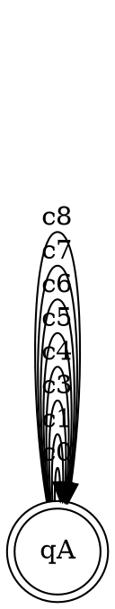

# Büchi–Mealy Product (Mealy × Büchi) Definition + Worked Example

This note defines a **product construction** between a **Mealy machine** and a **Büchi automaton** (DBA/BA), yielding a **Büchi–Mealy machine**. Then we instantiate it on a concrete PMM (as a Mealy machine) and the Büchi automaton for the LTL constraint **G ¬c2**.

---

## 1) Ingredients

### 1.1 Mealy machine (possibly partial)

We model the Mealy machine as:

\[
\mathcal{M} = (Q,\ q_0,\ X,\ Y,\ \delta,\ \sigma)
\]

- \(Q\): finite set of states
- \(q_0 \in Q\): initial state
- \(X\): input alphabet (domain)
- \(Y\): output range
- \(\delta: Q \times X \to Q\) (deterministic; or a partial function if some inputs are undefined)
- \(\sigma: Q \times X \to Y\) output function (can also be partial; typically defined when \(\delta(q,x)\) is defined)

> In edge-form, you may equivalently represent \(\delta\) as a transition relation
> \(\Delta \subseteq Q \times X \times Q\), where \((q,x,q') \in \Delta\) iff \(\delta(q,x)=q'\).

### 1.2 Büchi automaton (DBA/BA)

We model the Büchi automaton as:

\[
\mathcal{B} = (Q',\ q_0',\ X,\ \delta',\ F)
\]

- \(Q'\): finite set of states
- \(q_0' \in Q'\): initial state
- \(X\): input alphabet (same as Mealy)
- \(\delta': Q' \times X \to Q'\) (deterministic; or partial)
- \(F \subseteq Q'\): accepting set

**Büchi acceptance** on an infinite input \(w = x_0 x_1 x_2 \cdots\):
the induced run \(q_0' q_1' q_2' \cdots\) is accepting iff states from \(F\) are visited infinitely often.

---

## 2) Product Construction: Mealy × Büchi ⇒ Büchi–Mealy machine

Given:

- \(\mathcal{M} = (Q,\ q_0,\ X,\ Y,\ \delta,\ \sigma)\)
- \(\mathcal{B} = (Q',\ q_0',\ X,\ \delta',\ F)\)

Define the **product Büchi–Mealy machine**:

\[
\mathcal{P} = \mathcal{M} \otimes \mathcal{B}
= (Q_\otimes,\ q_{\otimes,0},\ X,\ Y,\ \delta_\otimes,\ \sigma_\otimes,\ F_\otimes)
\]

### 2.1 Product states and initial state

\[
Q_\otimes = Q \times Q', \quad
q_{\otimes,0} = (q_0, q_0')
\]

### 2.2 Product transition function (synchronous on the same input)

For deterministic machines:

\[
\delta_\otimes((q,r), x) =
(\delta(q,x),\ \delta'(r,x))
\]

**only defined if both** \(\delta(q,x)\) and \(\delta'(r,x)\) are defined.

Equivalently, in edge/relational form:

\[
((q,r),\ x,\ (q',r')) \in \Delta_\otimes
\iff
(q,x,q') \in \Delta \ \land\ (r,x,r') \in \Delta'
\]

i.e., **the product edge exists iff both component edges exist**.

### 2.3 Product output function (inherits Mealy output)

When the product transition exists,

\[
\sigma_\otimes((q,r), x) = \sigma(q,x)
\]

(i.e., the Büchi component does not contribute to output; it only filters legality and defines acceptance.)

### 2.4 Product input alphabet (intersection)

\[
X_\otimes = X_{\mathcal{M}} \cap X_{\mathcal{B}}
\]

The product machine's input alphabet is the **intersection** of the Mealy and Büchi alphabets. Any symbol that exists in one component but not the other has no valid synchronous transition and is therefore excluded.

### 2.5 Unreachable state pruning

After constructing the product transitions, any product state \((q, r)\) that is **not reachable** from the initial state \(q_{\otimes,0} = (q_0, q_0')\) via the product transition function \(\delta_\otimes\) is **recursively removed**, along with all its incident edges. Formally, the final state set is:

\[
Q_\otimes^{\text{reach}} = \{ s \in Q_\otimes \mid q_{\otimes,0} \xrightarrow{\delta_\otimes^*} s \}
\]

This pruning is necessary because:

1. Removing illegal-symbol transitions (symbols outside \(X_\otimes\)) may disconnect formerly reachable states.
2. The Büchi constraint may block the only path into certain Mealy sub-graphs, leaving them stranded.

### 2.6 Product accepting set (lift Büchi acceptance)

\[
F_\otimes = Q \times F = \{ (q,r) \in Q \times Q' \mid r \in F \}
\]

> If one "ignores" \(F_\otimes\), the remaining structure is simply a (possibly partial) Mealy machine over state space \(Q \times Q'\).

---

## 3) Worked Example

### 3.1 PMM (as a Mealy machine) — given DOT

```dot
digraph PMM {
  rankdir=LR;
  node [shape=circle, fontsize=11];
  q0 [label="q0\nrep: ε"];
  q1 [label="q1\nrep: 3"];
  q2 [label="q2\nrep: 3-7"];
  q3 [label="q3\nrep: 3-7-7-6"];
  q4 [label="q4\nrep: 3-7-7-6-6-6-0"];
  q5 [label="q5\nrep: 3-7-7-6-6-6-0-5-5"];
  q6 [label="q6\nrep: 3-7-7-6-6-6-0-5-5-2"];
  q7 [label="q7\nrep: 3-7-7-6-6-6-0-5-5-2-2-2-0"];
  q8 [label="q8\nrep: 3-7-7-6-6-6-0-5-5-2-2-2-0-4"];
  q9 [label="q9\nrep: 3-7-7-6-6-6-5-5-0"];
  q10 [label="q10\nrep: 3-7-7-6-6-6-5-5-0-1"];

  q0  -> q1  [label="c3 / [0.58, 2.52] p=1.00 next: [c7]"];
  q1  -> q2  [label="c7 / [0.51, 1.92] p=1.00 next: [c7]"];
  q2  -> q3  [label="c6 / [0.29, 1.88] p=1.00 next: [c6]"];
  q2  -> q2  [label="c7 / [0.23, 1.91] p=1.00 next: [c6]"];
  q3  -> q4  [label="c0 / [0.27, 1.59] p=1.00 next: [c0,c5]"];
  q3  -> q4  [label="c5 / [-0.02, 1.47] p=1.00 next: [c5]"];
  q3  -> q3  [label="c6 / [0.06, 1.92] p=1.00 next: [c0,c5,c6]"];
  q4  -> q4  [label="c0 / [-0.17, 1.45] p=1.00 next: [c0,c5]"];
  q4  -> q5  [label="c5 / [-0.26, 0.97] p=1.00 next: [c0,c2,c5]"];
  q5  -> q9  [label="c0 / [1.29, -0.99] p=1.00 next: [c1]"];
  q5  -> q6  [label="c2 / [-1.63, -0.73] p=1.00 next: [c2]"];
  q5  -> q5  [label="c5 / [-1.13, -1.36] p=1.00 next: [c2]"];
  q6  -> q7  [label="c0 / [-0.19, 1.01] p=1.00 next: [c4]"];
  q6  -> q6  [label="c2 / [-0.59, 0.65] p=1.00 next: [c0,c2]"];
  q7  -> q8  [label="c4 / [-0.42, -0.17] p=1.00 next: [c4]"];
  q8  -> q7  [label="c0 / [-0.56, -0.58] p=1.00 next: [c4]"];
  q8  -> q8  [label="c4 / [-0.50, -0.26] p=1.00 next: [c0,c4]"];
  q9  -> q10 [label="c1 / [1.51, -0.90] p=1.00 next: [c1]"];
  q10 -> q7  [label="c0 / [0.27, 0.97] p=1.00 next: [c4]"];
  q10 -> q10 [label="c1 / [2.09, -0.17] p=1.00 next: [c0,c1]"];
}
```

### 3.2 Büchi automaton for G ¬c2 — given DOT (partial BA, no c2 edge)

**Interpretation:** any run that ever reads `c2` has no defined transition in this BA (since we omitted a reject sink).

---

## 4) Product Result for This Example

Since the Büchi machine has:

- exactly **one state** \(q_A\) which is accepting,
- self-loops on **all symbols except `c2`**,

the product construction implies:

- **Product states:** \((q_i, q_A)\) for every PMM state \(q_i\).
- **Product transitions:** keep exactly those PMM edges whose input label is in \(\{c0, c1, c3, c4, c5, c6, c7, c8\}\). Any PMM transition on `c2` is removed (because BA has no `c2` transition).
- **Product outputs:** inherited from PMM edge outputs.
- **Product accepting set:** \(F_\otimes = Q \times \{q_A\}\), so **all product states are accepting**.

### 4.1 Product DOT (PMM × Büchi\_G\_not\_c2)

```dot
digraph Product_PMM_x_Buchi_G_not_c2 {
  rankdir=LR;
  node [shape=circle, fontsize=11];

  // Product states (all accepting since qA is accepting)
  p0  [label="(q0,qA)\nrep: ε", shape=doublecircle];
  p1  [label="(q1,qA)\nrep: 3", shape=doublecircle];
  p2  [label="(q2,qA)\nrep: 3-7", shape=doublecircle];
  p3  [label="(q3,qA)\nrep: 3-7-7-6", shape=doublecircle];
  p4  [label="(q4,qA)\nrep: 3-7-7-6-6-6-0", shape=doublecircle];
  p5  [label="(q5,qA)\nrep: 3-7-7-6-6-6-0-5-5", shape=doublecircle];
  p6  [label="(q6,qA)\nrep: 3-7-7-6-6-6-0-5-5-2", shape=doublecircle];
  p7  [label="(q7,qA)\nrep: 3-7-7-6-6-6-0-5-5-2-2-2-0", shape=doublecircle];
  p8  [label="(q8,qA)\nrep: 3-7-7-6-6-6-0-5-5-2-2-2-0-4", shape=doublecircle];
  p9  [label="(q9,qA)\nrep: 3-7-7-6-6-6-5-5-0", shape=doublecircle];
  p10 [label="(q10,qA)\nrep: 3-7-7-6-6-6-5-5-0-1", shape=doublecircle];

  // Product transitions: keep only those with labels allowed by Büchi (no c2).
  p0  -> p1  [label="c3 / [0.58, 2.52] p=1.00 next: [c7]"];
  p1  -> p2  [label="c7 / [0.51, 1.92] p=1.00 next: [c7]"];
  p2  -> p3  [label="c6 / [0.29, 1.88] p=1.00 next: [c6]"];
  p2  -> p2  [label="c7 / [0.23, 1.91] p=1.00 next: [c6]"];

  p3  -> p4  [label="c0 / [0.27, 1.59] p=1.00 next: [c0,c5]"];
  p3  -> p4  [label="c5 / [-0.02, 1.47] p=1.00 next: [c5]"];
  p3  -> p3  [label="c6 / [0.06, 1.92] p=1.00 next: [c0,c5,c6]"];

  p4  -> p4  [label="c0 / [-0.17, 1.45] p=1.00 next: [c0,c5]"];
  p4  -> p5  [label="c5 / [-0.26, 0.97] p=1.00 next: [c0,c2,c5]"];

  p5  -> p9  [label="c0 / [1.29, -0.99] p=1.00 next: [c1]"];
  // REMOVED (blocked by Büchi): q5 → q6 on c2
  p5  -> p5  [label="c5 / [-1.13, -1.36] p=1.00 next: [c2]"];

  p6  -> p7  [label="c0 / [-0.19, 1.01] p=1.00 next: [c4]"];
  // REMOVED (blocked by Büchi): q6 → q6 on c2

  p7  -> p8  [label="c4 / [-0.42, -0.17] p=1.00 next: [c4]"];

  p8  -> p7  [label="c0 / [-0.56, -0.58] p=1.00 next: [c4]"];
  p8  -> p8  [label="c4 / [-0.50, -0.26] p=1.00 next: [c0,c4]"];

  p9  -> p10 [label="c1 / [1.51, -0.90] p=1.00 next: [c1]"];

  p10 -> p7  [label="c0 / [0.27, 0.97] p=1.00 next: [c4]"];
  p10 -> p10 [label="c1 / [2.09, -0.17] p=1.00 next: [c0,c1]"];
}
```

---

## 5) Key Takeaway

Because the Büchi automaton for **G ¬c2** contains no `c2` transition, the product simply **filters out all PMM transitions labeled `c2`**. The resulting product is thus the **maximal subgraph** of the PMM that never takes `c2`.
